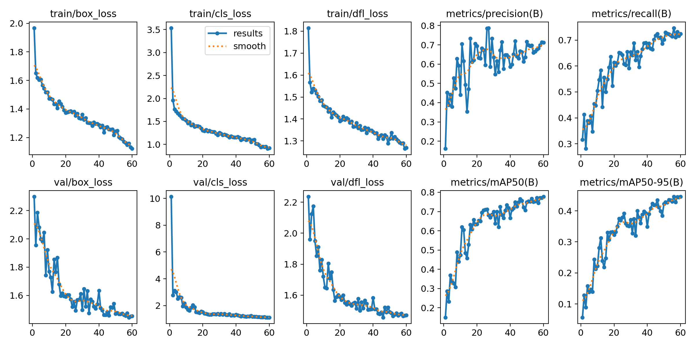
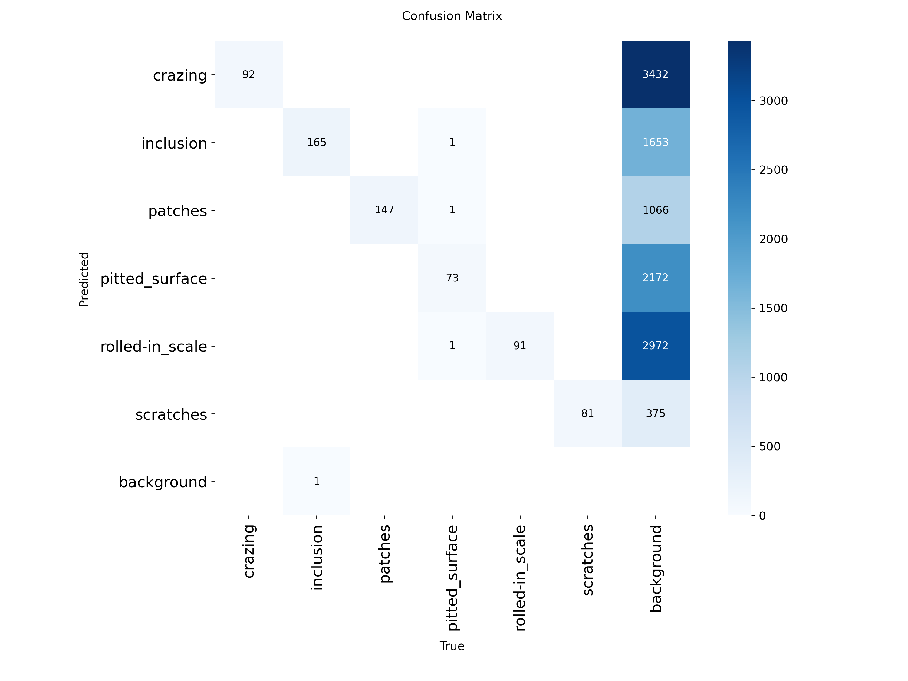

# DefectVision AI — Real-Time Visual Defect Detection

YOLOv8n trained on the NEU-DET dataset for industrial surface defect detection, designed for edge deployment.

## 📊 Model Evaluation
| Metric | Value |
|---|---|
| Model Architecture | YOLOv8 Nano |
| Dataset | NEU-DET (6 classes) |
| mAP50 | 0.7710 |
| mAP50-95 | 0.445 |

## 🖼️ Training Results

*Training progression showing loss decreasing over epochs.*


*Confusion matrix showing classification accuracy across the 6 defect types.*

## 📁 Repository Structure
- `models/best.pt`: The trained YOLOv8 weights (6.4 MB).
- `results/`: Training curves and confusion matrix.
- `requirements.txt`: Dependencies needed to run the model.

## 🚀 Quick Start (Inference)
To use the trained model on a new image:
```python
from ultralytics import YOLO

# Load the model
model = YOLO("models/best.pt")

# Predict
results = model.predict("path_to_your_image.jpg", save=True)